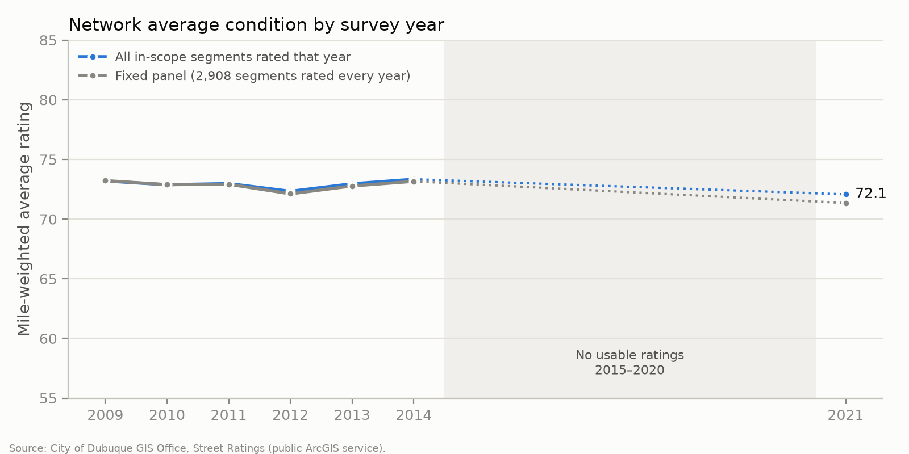
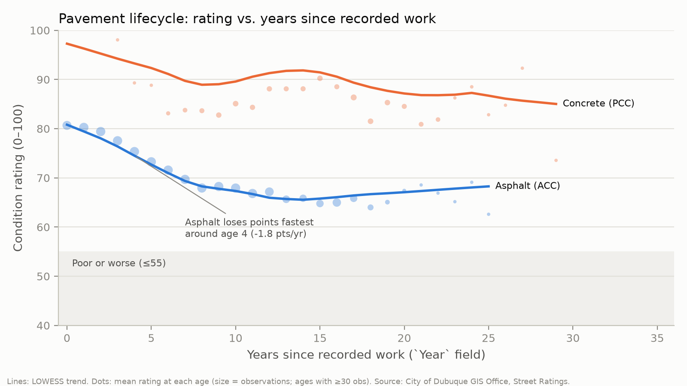
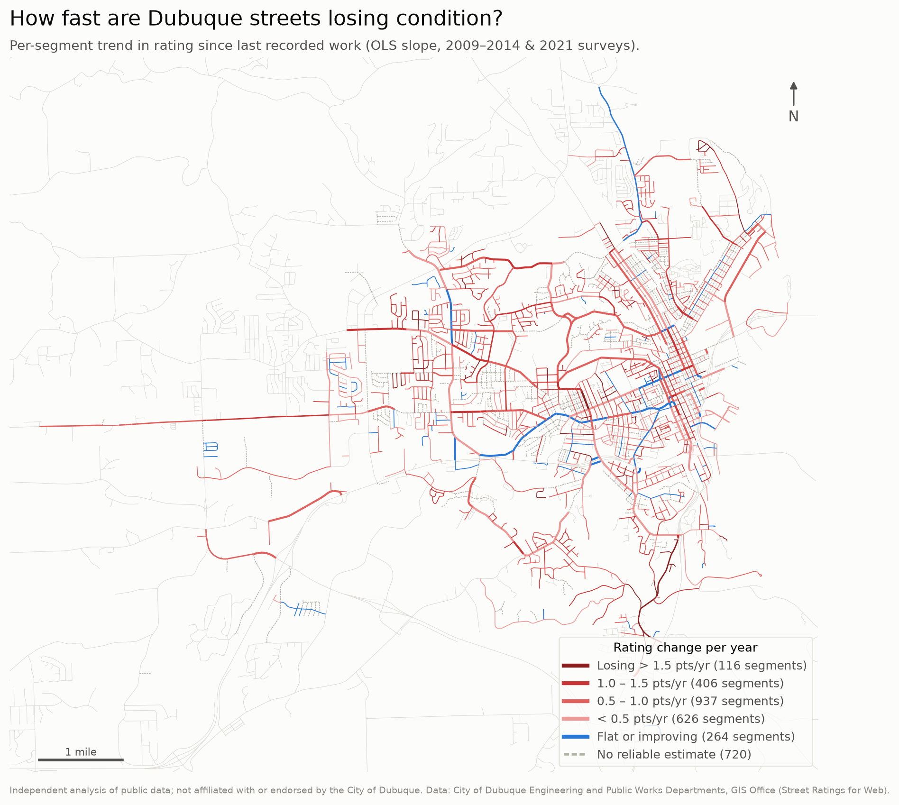

<!-- Generated by src/write_reports.py from src/templates/README.md. Edit the template, not this file. -->
# Dubuque street condition & pavement lifecycle analysis

An end-to-end analysis of the City of Dubuque's published street condition ratings: 3,069 City-rated street segments (266 centerline miles) tracked across seven condition surveys from 2009 to 2021. It covers how the network is trending, how fast pavement wears out, whether maintenance works, and which segments a capital program might look at first.

> **Independent work.** This is a personal portfolio project built on data the City of Dubuque GIS Office publishes openly. It is not affiliated with, reviewed by or endorsed by the City of Dubuque. The prioritization score is illustrative, not a City methodology.


**Explore:** [live interactive map](https://prashant3093.github.io/dubuque-street-conditions/) · [live dashboard](https://prashant3093.github.io/dubuque-street-conditions/dashboard.html) · [one-page findings](outputs/FINDINGS.md) · [full analysis report](outputs/analysis_report.md) · [data-quality report](outputs/data_quality.md)

## What the data shows

1. **The network is holding steady, not improving.** The mile-weighted average rating was 73.2 in 2009, 73.3 in 2014 and 72.1 in 2021. In 2021, 46% of miles were Good, 45% Fair, and **9.8% (26.1 miles) Poor or worse**.
2. **The Poor backlog shrank, then grew back.** Lane-miles rated Poor or worse fell from 65.2 (2009) to 42.1 (2014), then rose to **52.7 in 2021**. There are no ratings for 2015–2020, so the data can't say when in those years the reversal happened.
3. **A typical street loses about 0.66 points a year.** That's the median trend across 2,349 segments, and 90% of them are declining. Asphalt wears fastest in the first years after work, at about 1.8 points a year around year 4. Its median time to fall into the Poor band is about **26 years**.
4. **Resurfacing clearly works.** 476 segments with recorded work between 2010 and 2020 went from an average of 53.6 to 79.7, a gain of **+26.1 points**. That's +28.5 points net of untreated streets over the same years.
5. **Concrete declines at about 54% of asphalt's rate** (0.43 vs 0.79 points a year). Concrete carries more collector and arterial mileage (32% of its miles vs 23%) and its last recorded work is older (median 1999 vs 2005), so this is an association, not proof that concrete lasts longer.
6. **The data has gaps that would matter to a real program.** The 2015 survey is 95% placeholder zeros, 2016–2020 is missing, lane counts are missing on 94% of segments, and only 4.2% of segments have a traffic count.

<p align="center">
  
  
</p>



## Data-quality findings

Finding incomplete or inconsistent records was a core part of this work. Nothing was silently cleaned: every exclusion is counted in [`outputs/data_quality.md`](outputs/data_quality.md), and every row keeps a flag saying why.

| Issue | What I found | How it's handled |
|---|---|---|
| 2015 ratings | 95% of values are `0`; only 101 are real | The 0s are treated as *not collected*; 2015 is excluded from trends |
| `0` in other years | 152 on vacated/removed/taken-over streets, 90 before the street existed, 20 isolated gaps | Each 0 is classified by reason. None is read as "failed": the lowest real rating is 10 |
| 2022 column | 0 non-null values | Dropped |
| 2016–2020 | No columns at all | Stated in every trend; "year-over-year" for 2021 means vs. 2014 |
| Duplicate segment IDs | 140 segments appear on 297 rows; ratings are identical, only the maintenance text differs | Collapsed to one segment with every treatment kept |
| Service-side join | The 2021 Ratings layer returned 159 duplicate centerline rows | De-duplicated on OBJECTID; count verified against the service |
| Rows with no centerline ID | 17 rating rows | Kept in `data/processed/unmatched_ratings.csv`; not mappable |
| `Year` field | Ratings jump in that year, so it behaves like *most recent work*, not original construction | "Age" means years since recorded work |
| Lane counts | Missing on 2,878 of 3,069 segments | Assumed 2 lanes, flagged; lane-miles are approximate |
| Traffic counts (2013) | Present on 130 segments | A road-class proxy in the priority score, flagged |
| Brick streets | 13 segments rated as low as 10 every year, with no work recorded | Looks like a rating convention; excluded from trend statistics |
| Unchanging ratings | 334 segments have the same rating in every survey | Stable pavement, or ratings carried forward without re-inspection. Can't be told apart |
| Other gaps | Year missing 191, material missing 9, width missing or 0 28, road class missing 36; ZIP fields are undocumented codes 1–4 | Reported, not imputed |

**Scope.** I analyzed segments that appear in the City's own Street Ratings table, match a centerline, aren't retired, and have a 2021 rating: 3,069 segments. 3,007 of these carry the centerline maintenance code `MaintResp = 1`, which appears to mean City-maintained. The other 3,197 centerlines in the service are mostly county roads and neighboring towns (for example Centralia and Peosta) and have no ratings. They appear only as gray context on the maps.

## Methodology

**Condition bands.** The City doesn't document its 0–100 scale on the service. It behaves like a Pavement Condition Index, so I collapsed the seven ASTM D6433 PCI classes into four:

- **Good:** 71–100
- **Fair:** 56–70
- **Poor:** 26–55
- **Failed:** 1–25

"Poor or worse" means a rating of 55 or below. This is my assumption, so the backlog is reported at three thresholds: ≤50 gives 30.2 lane-miles, ≤55 gives 52.7, and ≤60 gives 101.9.

**1. Deterioration rate.** For each segment I fit an OLS slope of rating on year (statsmodels), with these rules:

- Only ratings taken in or after the recorded work year are used, so a repair doesn't count as "improvement".
- A segment needs at least 3 ratings spanning at least 5 years.
- 448 segments are excluded because their rating rose 10 or more points with no recorded work. That suggests unrecorded maintenance, which would contaminate the trend. Keeping them moves the median from −0.66 to −0.55.

**2. Material comparison.** I compared asphalt (n = 1,685) with concrete (n = 592) using three tests:

- a Welch t-test;
- a Mann-Whitney test;
- an OLS model adjusting for functional class and years since work, with HC3 robust standard errors.

In the adjusted model, concrete's coefficient is +0.28 points per year [0.23, 0.33]. Traffic counts are too sparse to control for load, so material stays confounded with how each road is used.

**3. Lifecycle curve.** Rating vs. years since recorded work, smoothed with LOWESS and fit separately for asphalt and concrete. Time to Poor uses a Kaplan-Meier estimate (2,775 segments, 371 reached Poor), censored at the last observation. For the whole network the median isn't reached: 81% of segments are still above Poor 20 years after work. The pooled curve rises after about year 10 because of survivorship and material mix, so the material-specific curves are the ones to read.

**4. Maintenance effectiveness.** For each segment with a work year between 2010 and 2020, I took the last rating before the work and the first rating after it. Each result is compared with the average change in untreated segments over the same two survey years, a simple difference-in-differences. By treatment family:

- **Overlay / resurface:** +26.1 points (n = 447)
- **Reconstruction:** +52.1 points (n = 12)
- **Preventive seal:** -5.0 points (n = 12)

The seal result is expected: seals slow decline rather than lift the rating, and these data can't measure slowed decline.

**5. Capital prioritization (illustrative).** The weights are set in `src/analysis.py` and each component is scaled 0–1:

| Component | Weight | Measure | Why |
|---|---|---|---|
| Condition | 40% | (100 − 2021 rating) / 100 | Current need |
| Deterioration | 20% | Percentile of decline rate (neutral if unknown) | Streets losing points fastest will need work soonest |
| Traffic | 25% | Percentile of 2013 count; road-class median if missing (Local 1,580, MajorCollector 5,150, MinorArterial 6,000, OtherPrincipalArterial 7,000) | More users benefit per repair |
| Size | 15% | Percentile of lane-miles | Share of the network affected |

The score is a starting point for a conversation, not a list to fund from. 96% of traffic inputs are a proxy, and only 9 of the top 50 have a real count. The ranking also moves with the weights. Under each alternative weighting, this many of the top 50 stay in the top 50:

- **Equal weights:** 44
- **Condition-heavy:** 21
- **No traffic:** 10

**6. Network KPIs.**

- Share of miles in each band.
- Mile-weighted average condition by survey year, shown both for all rated segments and for a fixed panel of 2,908 segments rated every year, so streets entering or leaving the inventory don't create false trends.
- Backlog lane-miles at or below the Poor threshold.

## Limitations

- **No ratings for 2015–2020.** Any change between 2014 and 2021 is a seven-year step with nothing in between.
- **Undocumented rating scale.** The band cutoffs are borrowed from ASTM D6433, not taken from the City.
- **Approximate lane-miles.** 95% of backlog segments use an assumed lane count.
- **Traffic data is from 2013 and covers few segments.**
- **No cost data.** Maintenance effectiveness is measured in rating points, not points per dollar, and the backlog can't be priced.
- **`Year` holds one value per segment.** For streets with several recorded treatments, it's ambiguous which one happened that year.
- **Ratings are subjective inspections.** Some appear to be carried forward unchanged.

## Reproduce it

You need macOS or Linux, Python 3.12 and [`uv`](https://docs.astral.sh/uv/).

```bash
git clone <this repo> && cd dubuque-street-conditions
uv sync                      # creates .venv from pyproject.toml / uv.lock
make all                     # fetch → build → analyze → maps → Power BI export → dashboard → README/FINDINGS
```

`make all` runs these steps in order:

| Step | Script | Output |
|---|---|---|
| Fetch | `src/fetch_data.py` | `data/raw/` (gitignored) + `data/raw/_manifest.json` |
| Build | `src/build_dataset.py` | `data/processed/*.parquet`, `analysis_table.csv`, `outputs/data_quality.md` |
| Analyze | `src/analysis.py` | `outputs/analysis_report.md`, `outputs/metrics.json`, `outputs/tables/`, charts |
| Maps | `src/maps.py` | `outputs/figures/*_map*.png`, `outputs/dubuque_streets.html` |
| Export | `src/export_powerbi.py` | `outputs/powerbi/*.csv` (star schema) |
| Dashboard | `src/dashboard.py` | `outputs/dashboard.html` |
| Reports | `src/write_reports.py` | `README.md`, `outputs/FINDINGS.md` (rendered from `src/templates/`) |

The fetcher is idempotent. It pages the ArcGIS REST service 500 records at a time, retries with backoff when the service returns 500 errors (it does, intermittently), and checks fetched counts against the service's own count. If the City updates the data, the counts and every number in this README update with it.

## Repository layout

```
src/                 pipeline scripts (above) + templates for README/FINDINGS
data/raw/            API pulls (gitignored) — only _manifest.json is committed
data/processed/      segments, long-format ratings, GIS exports
outputs/
  FINDINGS.md        one-page summary for a Public Works audience
  analysis_report.md full statistical output
  data_quality.md    every data-quality count
  metrics.json       every number quoted anywhere in this repo
  tables/            supporting CSVs (priority list, KPIs, lifecycle curve, ...)
  figures/           maps and charts
  powerbi/           star schema CSVs + report build spec with DAX
  dashboard.html     self-contained interactive dashboard
  dubuque_streets.html  interactive Leaflet map
docs/                GitHub Pages copies of the map and dashboard, plus the QGIS / ArcGIS guide
```

For desktop GIS, [`docs/gis_guide.md`](docs/gis_guide.md) rebuilds the condition map in QGIS: it joins the attribute CSV on `CenterlineID`, applies graduated symbology and exports a print layout to PDF. It also explains how to show the layer in ArcGIS Online. For Power BI, [`outputs/powerbi/README.md`](outputs/powerbi/README.md) specifies the data model, relationships, DAX measures and page layouts.

## Data source

City of Dubuque Engineering and Public Works Departments, GIS Office, from the **Street Ratings for Web** ArcGIS REST service:
`https://maps.cityofdubuque.org/arcgisweb/rest/services/Street_Ratings_for_Web/MapServer`

The data was pulled on **2026-10-06** and comprises 3,274 rating records (table 3) and 6,354 centerline features (layer 2). The pull details are in [`data/raw/_manifest.json`](data/raw/_manifest.json).

## License

The code is MIT-licensed (see [LICENSE](LICENSE)). The underlying data belongs to the City of Dubuque and is subject to the City's terms.
