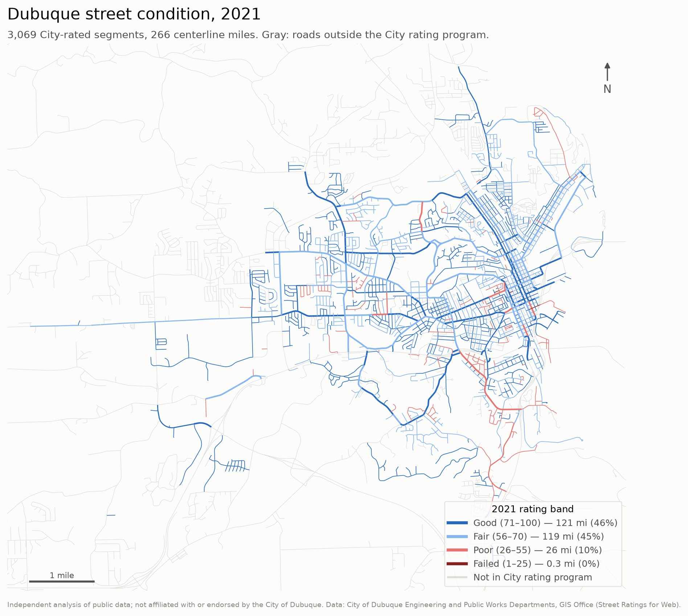

<!-- Generated by src/write_reports.py from src/templates/FINDINGS.md. Edit the template, not this file. -->
# Dubuque streets: what the condition ratings say

*A one-page summary of an independent analysis of the City's published street ratings (pulled 2026-10-06). It isn't affiliated with or endorsed by the City of Dubuque. Every number below is produced by code in this repository.*

**Scope:** 3,069 City-rated segments · 266 centerline miles · surveys from 2009–2014 and 2021

## Findings

1. **Condition is flat: not getting worse, not getting better.** The network averaged 73.2 in 2009 and 72.1 in 2021, on a 0–100 scale weighted by miles. Today 46% of miles are Good, 45% Fair, and **9.8% (26.1 miles) Poor or worse**.

2. **The Poor backlog was shrinking until 2014, then grew back.** Lane-miles rated Poor or worse went from 65.2 in 2009 to 42.1 in 2014, then to **52.7 in 2021**. The turn happened somewhere in 2015–2020, which has no ratings.

3. **Resurfacing pays off immediately and visibly.** Streets with recorded work between 2010 and 2020 (mostly overlays) went from 53.6 to 79.7 on average, **+28.5 points better than comparable untreated streets** (476 segments). Preventive seals didn't lift ratings (-5.0 points). That's expected: their value is slower decline, which this data can't measure yet.

4. **Asphalt loses condition fastest in its first five years.** A typical street drops 0.66 points a year. Asphalt drops about 1.8 points a year around year 4 after work, and typically reaches Poor after about **26 years**. That early window is where preventive treatments should matter most. Testing whether they pay off needs cost and treatment data.

5. **Concrete holds up better, but don't over-read it.** Concrete loses about 54% as many points per year as asphalt (0.43 vs 0.79). But concrete carries more collector and arterial mileage (32% of its miles vs 23%), its last work is older (median 1999 vs 2005), and traffic load can't be controlled for. This isn't a like-for-like comparison.

6. **The data itself is the biggest constraint.** The 2015 survey was never loaded (95% zeros), and 2016–2020 is missing entirely. Lane counts are missing on 94% of segments, and only 4.2% have a traffic count. Fixing these would sharpen every number above.

## Where a capital program might look first: top 10 (illustrative)

The score weights current condition 40%, rate of decline 20%, traffic 25% and segment size 15%. **It isn't a City methodology.** Most traffic figures (marked *) are estimates by road class, and the list changes noticeably if the weights change. Several entries are consecutive blocks of the same street (Rockdale Rd appears 5 times), so a real program would group them into projects.

| Rank | Street | Block | Road class | 2021 rating | Trend (pts/yr) | Traffic (2013) |
|---:|---|---|---|---:|---:|---:|
| 1 | Rockdale Rd | Fox Dr → Southern Ave | MajorCollector | 50 | -1.51 | 5,150* |
| 2 | Carter Rd | Asbury Rd → Karen St | MajorCollector | 60 | -1.31 | 14,200 |
| 3 | Twin Valley Dr | Rockdale Rd → Southpark Ct | MajorCollector | 50 | -2.15 | 5,150* |
| 4 | Rockdale Rd | Mar Jo Hills Rd → Old Mill Rd | MajorCollector | 50 | -1.51 | 5,150* |
| 5 | Carter Rd | Karen St → Kaufmann Ave | MajorCollector | 60 | -1.31 | 14,200 |
| 6 | Rockdale Rd | Tomahawk Dr → Fox Dr | MajorCollector | 50 | -1.51 | 5,150* |
| 7 | Asbury Rd | Crissy Dr → Evergreen Dr | MinorArterial | 60 | -1.21 | 14,700 |
| 8 | Rockdale Rd | Old Mill Rd → Brian Dr | MajorCollector | 50 | -1.51 | 5,150* |
| 9 | Rockdale Rd | Brian Dr → Twin Valley Dr | MajorCollector | 50 | -1.51 | 5,150* |
| 10 | Chaney Rd | Saint Anne Dr → Pennsylvania Ave | MajorCollector | 55 | -1.23 | 5,150* |

## What I would ask for next

- **Work-order and contract costs by segment**, to turn "points gained" into points per dollar and price the 52.7 lane-mile backlog.
- **Ratings after 2021 and the missing 2015–2020 surveys**, to see when the backlog turned and whether it is still growing.
- **Current traffic counts and lane counts**, so the prioritization rests on measured traffic and true lane-miles.
- **Sewer and storm condition data (including inflow and infiltration) and fleet data**, to coordinate street work with what lies underneath and plan equipment needs.

## What an Enterprise Asset Management system would automate

Most of this analysis was reconciling records: segments stored once per treatment, a work year that means "last work" rather than construction, and zeros standing in for missing surveys. An EAM system would make the following routine:

- **Asset records:** one record per segment, with condition inspections and work orders linked to it automatically.
- **Live tracking:** deterioration curves and Poor-backlog KPIs updated as inspections are entered.
- **Validation rules:** catching a 0 rating or a missing lane count at entry instead of years later.
- **Planning scenarios:** "what if we spend $X on overlays vs. seals" scenarios, built on the same lifecycle curves shown here.
